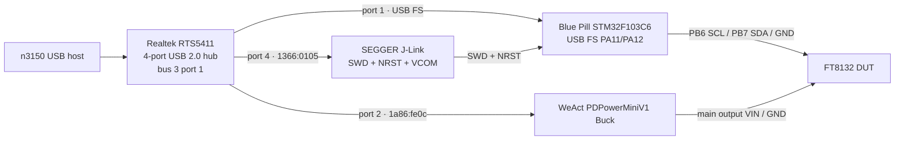

# FT8132 probe workbench

Bench on host `n3150` (Debian 13, kernel `6.12.86+deb13-amd64`). Snapshot: **2026-10-15 06:44 UTC** (14:44 CST).

Firmware knocks an FT8132 on PB6/PB7, then speaks USB MSC / SCSI (`VID:PID 1b3f:8000`) so `host/ft8132/` and FT8132Debugger can run Find / registers. Protocol vs the official GUI: [gui.md](gui.md). cflash findings, the program-clock guard, and the stuck-SDA state of this part: [cflash.md](cflash.md).

## Topology



Power domains are separate:

- Blue Pill 3.3 V from its USB 5 V regulator. J-Link `VTref` is **3.300 V**.
- FT8132 is **not** fed 3.3 V from the Blue Pill. SCL / SDA / GND go to the Blue Pill; SCL and SDA also have 4.7 kΩ pull-ups to 5 V. DUT power is the PDPowerMiniV1 main output.

## USB map (live)

All three gadgets hang off one Realtek hub:

| Hub port | Sysfs | Device | VID:PID | Serial | Node |
|----------|--------|--------|---------|--------|------|
| 3-1 | `0bda:5411` | Generic 4-port USB 2.0 Hub (RTS5411, bcd `0104`) | — | — | — |
| **3-1.1** | `1b3f:8000` | Blue Pill USB FS (`usbdisk2`) | none | `/dev/sg2` (+ `sd?` removable, no medium) |
| 3-1.2 | `1a86:fe0c` | WeAct Studio **PDPowerMiniV1** | `acdeb4545ce4` | `/dev/ttyACM0` |
| 3-1.4 | `1366:0105` | SEGGER **J-Link** | `000063728726` | `/dev/ttyACM1` + SWD |

Port **3-1.3** is unused.

```
Bus 003 Device 077: ID 0bda:5411 Realtek Semiconductor Corp. RTS5411 Hub
Bus 003 Device 078: ID 1a86:fe0c QinHeng Electronics PDPowerMiniV1
Bus 003 Device 079: ID 1366:0105 SEGGER J-Link
Bus 003 Device 115: ID 1b3f:8000 Generalplus Technology Inc.
```

CDC ACM stays **PSU = `ttyACM0`**, **J-Link VCOM = `ttyACM1`** while both stay plugged in. Match on USB serial (`ID_SERIAL_SHORT`) in scripts. `/dev/sg0` and `/dev/sg1` are SATA (ahci), not the probe.

The sg node is `root:disk`. The login user is in `plugdev` and `dialout`, **not** `disk`, and there is no `1b3f:8000` udev rule. After each re-enum: `uv run --project scripts bench chmod`. Or install:

```
SUBSYSTEM=="scsi_generic", ATTRS{idVendor}=="1b3f", ATTRS{idProduct}=="8000", MODE="0660", GROUP="plugdev"
```

## STM32F103C6 Blue Pill

Confirmed over SWD (`probe-rs` 0.31.0 + OpenOCD 0.12.0 / J-Link):

| Item | Value |
|------|--------|
| Core | Cortex-M3 r1p1, SWD `DPIDR 0x1ba01477` |
| `DBGMCU_IDCODE` (`0xE0042000`) | `0x10006412` (DEV_ID `0x412`, rev `0x1000`) |
| Flash size (`0x1FFFF7E0`) | **32 KiB** (`0x0020`) — **C6**, matches `memory.x` |
| Unique ID (`0x1FFFF7E8`) | `05d6ff34 3930564d 43066844` |
| Option bytes | RDP level 0 (`0xA5`), flash writable |
| HSE | 8 MHz (board crystal; firmware PLL ×9 → 72 MHz, USB 48 MHz) |
| USB pins | PA11 D−, PA12 D+, always-on 1.5 kΩ D+ pull-up |
| ASIC bus | **PB7 SDA**, **PB6 SCL** — GPIO knock, then software open-drain I2C. External **4.7 kΩ** on each line to **5 V**; internal pull-up off. Hardware I2C1 is not used. |

`.cargo/config.toml` runner is `probe-rs run --chip STM32F103C6`. Prefer `probe-rs download` + `probe-rs reset` so the debugger does not stay attached.

### Current MCU state (snapshot)

Vector table at `0x08000000` is `20002800 080000f1` (image present). USB `1b3f:8000` is on hub port 3-1.1 as `/dev/sg2`. `uv run ft8132 list` returns that node.

If flash is erased (`0x08000000` all `0xFF`) the always-on D+ pull-up still looks like a FS device and the host logs `device descriptor read/64, error -32` / `unable to enumerate`. Reflash: `uv run --project scripts bench flash` (or `… flash --mock`).

`probe-rs download --connect-under-reset` has timed out on this J-Link; attach without it, then NRST reset. SYSRESETREQ-only is not enough if the F103 AHB is wedged (wrong PMA layout used to do that).

## J-Link

| Item | Value |
|------|--------|
| USB | `1366:0105`, serial `000063728726` |
| OpenOCD banner | `J-Link OB-Mini Plus-CortexM` (HW 1.00; firmware date string `Mar 8 2099`) |
| `VTref` | 3.300 V |
| Transport | SWD @ 1 MHz |
| Reset | **NRST is wired.** `reset_config srst_only srst_nogate` |
| VCOM | `/dev/ttyACM1` (unused; firmware is `panic-halt`) |
| Access | `plugdev` via distro OpenOCD udev (`60-openocd.rules`) |

```
[0]: J-Link -- 1366:0105:000063728726 (J-Link)
```

## FT8132 DUT

Wired **SCL / SDA / GND**, plus **4.7 kΩ** from SCL and from SDA to a separate **5 V** rail (2026-10-21). Do not tie those resistors to FT8132 `VDD5`; the datasheet defines `VDD5` as an LDO output. After knock the chip listens at I2C address `0x00`; Find wants `reg 0x01 == 0x02`.

Knock is the captured 1 µs SCL pattern (`18×0` + `E8 E8 8E EF`, twice) with SDA held low, timed from DWT `CYCCNT` with IRQs masked. `cortex_m::asm::delay(72)` is several cycles per loop and stretched the bits to ~3–4 µs — the ASIC then never entered I2C.

I2C after knock is GPIO open-drain bit-bang. A released pin is Hi-Z (`set_as_input_output`, ODR high); the external resistors make the high. PB6/PB7 are 5 V tolerant in that mode. The F1 I2C block latches BUSY if SDA is still low when PE is set. ACK sampling must not wait for SDA high (ACK is SDA low). If addr `0x00` NACKs, firmware retries with PB6/PB7 swapped.

Last successful Find on this bench: `ident` 0x81, `chip_id` 2, `comm_status` 0, `bflash_111` 0. `state` showed live `theta` / `speed` / `udc`, `motor_status` 4, `fault` 0.

DUT is unpowered while PSU output is off. Do not expect Find until VIN is up.

## WeAct PDPowerMiniV1 (programmable PSU)

Vendor docs: [WeActStudio.PDPowerMiniV1-Buck](https://github.com/WeActStudio/WeActStudio.PDPowerMiniV1-Buck).

USB CDC control (Type-C to the host), not the optional UART-on-DP/DM. Example: [`com_pdpower.py`](https://github.com/WeActStudio/WeActStudio.PDPowerMiniV1-Buck/blob/master/Communication%20protocol/com_pdpower.py) (USB protocol v1.2).

| Item | Live value |
|------|------------|
| USB | `1a86:fe0c`, CDC ACM, 12 Mb/s, MaxPower 100 mA |
| Product string | `PDPowerMiniV1` / `WeAct Studio` |
| `who_am_i` | `WeAct Studio PD Power Mini V1 BUCK` |
| Firmware | `V1.0.2.0_6a997d9a` |
| Device serial | `acdeb4545ce4` |
| TTY | `/dev/ttyACM0` (`dialout`) |
| Input | **DC**, ~**20.36 V** (PD request setting 24.0 V) |
| Output enable | **on** (`0x01`) |
| Channel 0 setpoint | **15.00 V / 3.10 A** |
| Displayed V/I | **15.01 V / ~0.12 A** |
| OCP enable | 0 (off) |
| Offset / calibration | 1 (on) |
| Brightness | 10 |

Rated output is 1–20 V / 0.05–3 A. 3.10 A is the spec ceiling; 2 A is the long-term rating without extra cooling. This eval/motor board takes **15 V VIN** and regulates locally. SCL/SDA idle at **5 V** through the external 4.7 kΩ resistors. Confirm setpoint before `output_enable` on a different DUT.

### USB CDC framing (enough to power-cycle)

8-N-1, 115200 on the ACM port (kernel ACM baud is often ignored; 115200 matches the vendor example). Terminator `0x0A`. Bit 7 = read (`CMD_READ = 0x80`).

| Host → device | Meaning |
|---------------|---------|
| `81 0A` | who am I |
| `C2 0A` | firmware version |
| `C3 0A` | serial |
| `82 0A` | output enable? |
| `02 00 0A` | **output off** |
| `02 01 0A` | **output on** |
| `85 0A` | measured V/I (mV, mA, little-endian u16) |
| `8A 0A` | input state: `DC=6`, VIN mV, PD-set ×0.1 V |
| `84 <id> 0A` | read setpoint for channel `id` |
| `04 <id> Vlo Vhi Ilo Ihi 0A` | write setpoint (mV, mA) |

`uv run --project scripts bench psu status` / `on` / `off` / `cycle` (does not change the setpoint).

Vendor note (UART-on-Type-C, **not** this CDC gadget): `UART Mode` in the on-device menu puts DP=TX / DM=RX at 3.3 V; the adapter needs reverse-current protection (e.g. CH340K) or the Mini fails to start.

## Host software on this machine

| Tool | Path / version |
|------|----------------|
| Rust | 1.99.0 (`rust-toolchain.toml`), target `thumbv7m-none-eabi` |
| `probe-rs` | `~/.cargo/bin/probe-rs` 0.31.0 |
| OpenOCD | `/usr/bin/openocd` 0.12.0 |
| `uv` / Python CLI | `scripts/` (`bench`) path-depends `host/ft8132/` |
| pyserial | via `scripts/` (PSU CDC) |

User `wushuang` is in `dialout` and `plugdev`. J-Link and PSU TTY need no extra chmod. Blue Pill `sg` nodes do.

## Typical session

```bash
uv run --project scripts bench psu status      # confirm 15 V setpoint
uv run --project scripts bench psu on
uv run --project scripts bench flash
uv run --project scripts bench chmod
uv run --project scripts bench list
uv run --project scripts bench find
uv run --project scripts bench state
uv run --project scripts bench reg get 0x00
uv run --project scripts bench psu cycle       # if the ASIC latches up (VIN only)
```

## See also

- [gui.md](gui.md) — FT8132Debugger vs this firmware.
- [../scripts/README.md](../scripts/README.md) — flash / PSU / Find.
- Repo `README.md` / `AGENTS.md` — pins, clocks, flash budget.
- [WeAct PDPowerMiniV1](https://github.com/WeActStudio/WeActStudio.PDPowerMiniV1-Buck) — PSU spec and `com_pdpower.py`.
